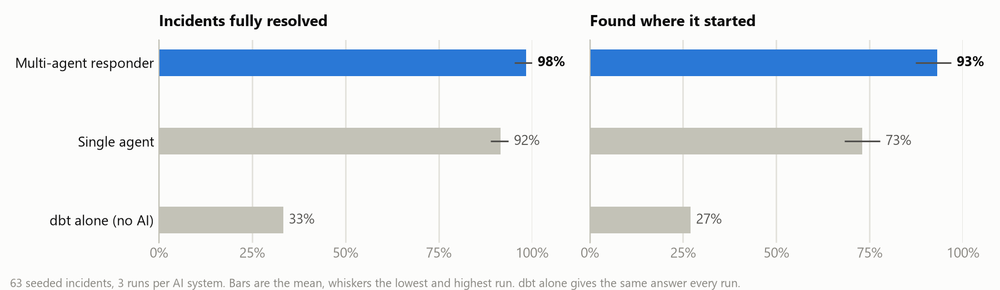
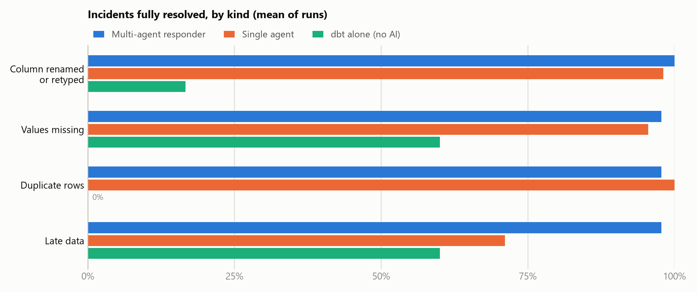

# data-incident-responder

When a dbt build fails, someone has to work out what broke, where it started, and whether it is safe to fix
or has to go back to whoever owns the data. This project gives that job to a small team of LLM agents and
measures how well they do it on 63 seeded incidents with answer keys, against a single agent and against dbt
on its own.

Nothing the agents do is applied. Every incident ends in a report for a person to review: a proposed fix with
its diff and a dry-run result, or an escalation to the source owner with the evidence.

<picture>
  <source media="(prefers-color-scheme: dark)" srcset="docs/results-dark.png">
  
</picture>

| 63 incidents, mean of 3 runs | Multi-agent responder | Single agent | dbt alone |
|---|---|---|---|
| Resolved | **98.4%** (95.2 to 100) | 91.5% (88.9 to 93.7) | 33.3% |
| Found where it started | **93.1%** (87.3 to 96.8) | 73.0% (68.3 to 77.8) | 27.0% |
| Right action (fix or escalate) | **98.4%** | 93.1% | 33.3% |
| Held-out incidents resolved (13) | **100%** | 94.9% | 38.5% |
| Fixes proposed | 123 | 127 | 0 |
| Fixes that should not have been made | **0** | 10 | 0 |
| Tokens per incident | 20.4k | 27.8k | 0 |

The numbers in brackets are the lowest and highest of the three runs. "Resolved" means the right call was made:
an escalation where the data has to be corrected at the source, or a fix that passes a hidden check the agents
never see (see [Evaluation](#evaluation)).

The clearest difference is safety. Over three runs the responder proposed 123 fixes and every one passed the
hidden check. The single agent, with the same model, tools and budget, proposed 127, and 10 of them failed: 7 were
for incidents that only the source owner could fix, mostly late data it tried to work around, and 9 of the 10
did not build at all even though the agent had the same dry-run tool. The responder's dry-run gate and reviewer
are what stop those.

## How it works

```
failed dbt build
  -> triage       reads the failing checks, guesses the kind of incident
  -> investigate  walks lineage upstream with read-only SQL until it finds where the problem starts
  -> fix          rewrites one model file; the patch is built in a throwaway copy, up to 3 tries
  -> review       hard policy rules first, then a model reviewer; a rejected fix goes back once
  -> report       markdown report for a person, fix or escalation
```

The agents are a LangGraph graph and see the warehouse only through an MCP server
([`mcp_server.py`](src/responder/mcp_server.py)) with seven tools:

| Tool | What it does |
|---|---|
| `get_test_results` | failing checks and their messages from dbt's `run_results.json` |
| `get_lineage` | parents, children and checks of a model or source from dbt's manifest |
| `get_model_sql` | the SQL of a model |
| `list_tables` | tables and column types per schema |
| `run_sql` | one read-only SELECT; parsed with sqlglot, schema allow-list, no file reads, personal columns masked, 50 rows, 5 s timeout |
| `profile_column` | whether a changed column converts to the type its contract expects without losing anything |
| `try_patch` | builds the project with one model file replaced, in a copy, and reports what fails |

The rules the agents follow are a small team policy:

- A renamed column carries the same data, so the staging model follows the new name.
- A type or format change is fixed only if it is lossless. `profile_column` checks every value: does it parse
  (trying the common date formats, not just the default), would the cast round anything, and does the source
  still send the decimal places the contract keeps. Rounded prices or unparseable dates go to the source owner.
- Rows duplicated identically in every column are a batch delivered twice and are deduplicated. Rows that
  share a key but differ are a conflict for the source owner.
- Missing or late data is escalated. No downstream change can honestly put it back.

Two example reports from the final run: [duplicate rows, fixed](docs/examples/duplicate-rows-fixed.md) and
[prices arriving rounded, escalated](docs/examples/rounded-prices-escalated.md).

## Evaluation

**Warehouse.** TPC-H at scale factor 0.01 in DuckDB, built with dbt: six staging views with enforced column
contracts, four marts and 35 checks (generic tests plus four singular tests for ranges, freshness and grain).

**Incidents.** 63, each a change to the source data or to a model, with an answer key: where it started,
whether the cause is upstream data or model code, and whether the right action is to fix or escalate.

| Kind | Incidents | Fix | Escalate |
|---|---|---|---|
| Column renamed or retyped | 18 | 15 | 3 |
| Values missing | 15 | 6 | 9 |
| Duplicate rows | 15 | 15 | 0 |
| Late data | 15 | 6 | 9 |

45 start in the source data and 18 in a model. 13 of them (spread across the four kinds) were held out and not
looked at while the system was developed. Every incident in the kit is checked to really trip an alarm, and
every fixable one is checked to be fixable by a reference patch ([`kit.py`](src/responder/kit.py)).

**Hidden check.** A fix only counts if the patched project builds and passes, the checks themselves are
unchanged (their definitions are hashed), and the marts match fingerprints of the clean warehouse. A fix can't
pass by editing a test, dropping rows or filling in values.

**Baselines.** The single agent uses the same model, the same tools including `try_patch` and
`profile_column`, and the same budget, but investigates and fixes in one loop with no reviewer. dbt alone
raises the alarm and escalates everything.

**Runs.** `gpt-oss-120b` served with vLLM on one A100, temperature 0, every incident three times per AI system
([notebook](notebooks/evaluation_run.ipynb)). vLLM is not fully deterministic even at temperature 0, so the
runs differ a little. Runs are traced in Langfuse.

<picture>
  <source media="(prefers-color-scheme: dark)" srcset="docs/by_kind-dark.png">
  
</picture>

Compared incident by incident (majority of the three runs), the responder finds where the problem started on 15
incidents where the single agent doesn't, against 2 the other way (sign test p = 0.002). On resolving, it is 5
to 0 (p = 0.06): a consistent edge, but on its own not conclusive at this sample size. The single agent's
misses cluster in late data, where it confuses data that hasn't arrived (escalate) with a model that filters it
out (fix), and it usually names the file it edited rather than the source that changed.

## What I took away

Going in, I expected the multi-agent setup to win on accuracy. It mostly didn't need to: a single agent with
the same tools resolves over 90% of these incidents too. Where the split pays off is in what happens when the
model is wrong. A single agent that has talked itself into a fix will submit it, sometimes without checking
whether it even builds, while the responder's fixer has to get past a dry run and a reviewer that doesn't share
its reasoning. Over three runs that difference was 10 bad fixes against none, and in incident response that
matters more than a few points of accuracy. The other surprise was how much the tools mattered. Before the
column profiler existed, both systems kept getting type changes wrong, either casting a column that had lost
its cents or giving up on dates that were only in a different format. Adding the profiler took the responder
from 71% to 93% on renamed and retyped columns in development, because "is this type change safe?" became a
measured answer instead of a guess.

## Limitations

- The 50 development incidents were used to tune the system over four runs, so their numbers are optimistic.
  The 13 held-out incidents were resolved in all three runs, but 13/13 still only bounds the true rate at
  roughly 77% to 100%.
- Some misses are stable. The responder blames customers instead of nations for a missing region key in every
  run, and for dates that arrive in US format it names the staging model rather than the source, although the
  fix it makes is correct.
- One model, one synthetic warehouse at a small scale. `try_patch` copies the whole DuckDB file, which works
  here but not for a production warehouse, where it would need to build the changed models into a scratch
  schema instead.

## Running it

```bash
python -m venv .venv
.venv/bin/pip install -e ".[dev,figures]"
cp .env.example .env
python -m responder.warehouse --path kit/source.duckdb
pytest
```

One incident against Groq's API (fine for a quick look; its free tier rate limits long investigations), or a
whole system against a vLLM server:

```bash
python -m responder.run --system multi --ids inc034 --provider groq --out runs/try
python -m responder.run --system single --provider vllm --workers 8 --out runs/final/single-1
python -m responder.compare runs/final
python -m responder.figures runs/final --out docs
```

The full evaluation runs on Colab with [`notebooks/evaluation_run.ipynb`](notebooks/evaluation_run.ipynb).
The cross-run numbers above are in [`docs/final_results.json`](docs/final_results.json).

```
src/responder/
  agents.py           the graph and the single-agent baseline
  tools.py            read-only sql guard, lineage, profiling, dry runs
  mcp_server.py       the tools over MCP
  incidents.py        the 63 incidents and their answer keys
  kit.py, workspace.py  building and checking incidents, the hidden check
  run.py              runs a system over incidents and scores it
  incident_report.py  the report written for every incident
  report.py, compare.py, figures.py
warehouse/            the dbt project
```
